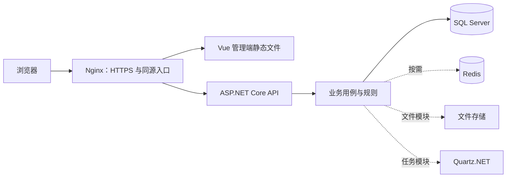

# Qizhu 全栈技术选型

更新日期：2026-10-15。

数据模型、类型映射、并发与 API 契约、Identity / 租户 / 配额、安全、恢复及容量等具体决定见[数据、接口、安全与运行规范](platform-standards.md)。本文负责技术组件选型，该规范负责实现与验收默认值。

本文覆盖企业管理系统开发平台的前端、后端、数据层、身份权限、公共业务模块、测试和部署。目标是支持独立项目交付与 SaaS 多租户，并让后续项目复用代码、组件和工程规范。

**状态说明**：已接入表示当前工程已经使用；已配置表示已提供配置或接入点，但服务或完整业务尚未实现；建议采用表示后续建设的默认选型；按需采用表示仅在对应需求出现时引入。已接入版本以 Directory.Packages.props 和 web/package-lock.json 为准；未接入模块不会提前安装全部依赖。

SQL Server、SqlSugar 和 Vue 管理端已经接入。业务标识统一雪花 long，所有表位于 dbo，数据库时间统一 UTC；细节与限制见实现记录。

## 1. 总体方案

| 部分 | 默认技术组合 | 当前状态 |
| --- | --- | --- |
| 管理端 | Vue 3 + TypeScript + Vite + Element Plus + Vue Router + Pinia | 已接入，登录 / 概览 / 项目 / 安全设置 |
| 后端 | C# + .NET 10 + ASP.NET Core Web API | 已接入 |
| 数据层 | SQL Server + SqlSugarCore | 已接入，真实 SQL Server 2019 已验证 |
| 身份 | ASP.NET Core Identity + SqlSugar 自定义存储 + Cookie + Antiforgery | 已接入，持久化会话 / 登录 / CSRF / TOTP |
| 权限与租户 | ASP.NET Core Authorization + 自研 RBAC / 数据权限 / 租户模块 | 租户成员 / 平台与租户角色 / 项目权限已接入，完整数据权限待扩展 |
| 交付 | Docker + Docker Compose + Nginx + GitHub Actions | 后端 Dockerfile 和 CI 文件已配置，其余待接入 |

采用模块化单体，按业务组织模块，保留 Domain、Application、Infrastructure、Api 的依赖边界。管理端采用 SPA，通过 HTTP API 访问后端。

上图是目标结构，当前工程尚未部署这些外部服务。最小正式交付为管理端静态文件、API 和 SQL Server；按启用模块追加其他服务。

## 2. 前端技术栈

目录：项目根目录 `web/`。组件和代码按业务模块组织，避免将全部页面堆在一个目录。

| 技术 | 用途与约定 | 状态 |
| --- | --- | --- |
| [Vue 3](https://vuejs.org/guide/introduction.html) | 管理页面、布局和业务组件；使用 Composition API 与 script setup | 已接入 |
| [TypeScript](https://vuejs.org/guide/typescript/overview) | 业务模型、接口类型与组件参数；开启严格类型检查 | 已接入 |
| [Vite](https://vite.dev/guide/) | 开发服务、模块热更新、生产构建；开发时代理后端 API | 已接入 |
| [Element Plus](https://element-plus.org/en-US/component/overview) | 表格、表单、树、弹窗、上传、分页和中文界面 | 已接入 |
| [Vue Router](https://router.vuejs.org/introduction.html) | 页面路由、布局路由、导航守卫及权限菜单对应关系 | 已接入 |
| [Pinia](https://pinia.vuejs.org/introduction.html) | 当前用户、当前租户、权限、菜单与界面偏好等共享状态 | 已接入 |
| [Axios](https://axios-http.com/docs/intro) | 统一请求入口、超时、取消请求、错误提示和登录失效处理 | 已接入 |
| CSS / CSS Variables | 页面布局、主题色与设计变量；优先复用组件库样式 | 已接入 |
| [ECharts](https://echarts.apache.org/handbook/en/get-started/) | 统计报表、趋势图、管理看板 | 报表模块采用 |
| [Vue I18n](https://vue-i18n.intlify.dev/) | 多语言资源与界面语言切换；初期默认中文 | 多语言需求出现时采用 |
| [Vue Flow](https://vueflow.dev/) | 流程节点与连线的交互画布 | 自定义流程设计器需要时采用 |

Vue 官方脚手架支持创建 Vite 与 TypeScript 项目；Element Plus 提供后台常用表单和表格能力。[Vue 官方说明](https://vuejs.org/guide/typescript/overview)、[Element Plus 表单](https://element-plus.org/en-US/component/form)。

### 前端公共能力

- 统一管理布局、侧边菜单、顶部导航、面包屑、加载与空状态。
- 统一错误提示：400 展示业务或字段错误；401 提示重新登录；403 展示权限不足；500 展示通用提示与追踪编号。
- 类型化接口模型；后端 OpenAPI 稳定后，可采用 [openapi-typescript](https://openapi-ts.dev/introduction) 生成类型，Axios 请求封装继续由项目维护。
- 复用查询表格、编辑弹窗、树选择和上传组件；业务差异通过明确的参数和插槽扩展。
- 时间以 UTC 与后端交换，页面用浏览器 Intl API 按展示时区格式化。
- 前端菜单和按钮权限负责展示；后端必须独立检查接口权限和数据范围。

推荐业务模块内部保留页面、接口、类型和局部组件；真正跨模块复用的组件才进入公共组件目录。

## 3. 后端技术栈

| 技术 | 用途与约定 | 状态 |
| --- | --- | --- |
| C# / .NET 10 | 后端语言与运行平台；Nullable、异步、CancellationToken、TimeProvider | 已接入 |
| ASP.NET Core Web API / Controllers | HTTP 接口、模型绑定、标准状态码与模块入口 | 已接入 |
| 内置依赖注入 | 管理服务生命周期，在宿主集中装配依赖 | 已接入 |
| Options / DataAnnotations | 强类型配置、启动配置校验和基础请求校验 | 已接入 |
| System.Text.Json | HTTP JSON 序列化 | 已接入 |
| IExceptionHandler / ProblemDetails | 全局异常处理、稳定业务错误码、通用系统错误与追踪编号 | 已接入 |
| Microsoft.Extensions.Logging | 结构化请求与异常日志；不记录请求正文和凭证 | 已接入 |
| Microsoft.AspNetCore.OpenApi | 生成 OpenAPI 文档，目前只在 Development 开放 | 已接入 |
| ASP.NET Core Health Checks | 存活检查；外部依赖接入后增加就绪检查 | live 存活与 ready 数据库就绪已接入 |
| IHttpClientFactory + Microsoft.Extensions.Http.Resilience | 外部服务请求、连接管理、超时与弹性策略 | 外部接口模块采用 |
| ASP.NET Core Rate Limiting | 登录、导出等接口限流；多实例时明确限流作用范围 | 登录限流已接入，另有 SQL Server 原子窗口计量 |

业务规则继续使用领域实体与明确的业务服务，优先为持久化、时钟、主键、租户授权、会话和审计等变化点建立接口；共享持久化字段采用抽象基类，避免只有转发调用的空层。DTO 映射优先使用可读的显式代码。

接口约定沿用现有工程：成功返回 DTO / 分页 DTO，创建返回 201，资源不存在返回 404，校验失败返回 400，错误采用 ProblemDetails。[ASP.NET Core 错误处理](https://learn.microsoft.com/en-us/aspnet/core/web-api/handle-errors?view=aspnetcore-10.0)。

## 4. 数据库、缓存与租户隔离

| 技术或机制 | 用途与约定 | 状态 |
| --- | --- | --- |
| [SQL Server](https://learn.microsoft.com/en-us/sql/sql-server/?view=sql-server-ver16) | 默认关系数据库；业务数据、身份数据、租户配置与审计记录 | 已接入，SQL Server 2019 / compatibility level 150 为当前兼容基线 |
| [SqlSugar / SqlSugarCore](https://www.donet5.com/Home/Doc?typeId=1180) | ORM、实体映射、查询、分页与事务；SQL Server 使用 SqlSugar.DbType.SqlServer | 已接入，SqlSugarCore 5.1.4.221 |
| Microsoft.Data.SqlClient | SQL Server ADO.NET 驱动；SqlSugar SQL Server 数据访问及需要此驱动的任务存储使用 | 已作为 SqlSugar / DbUp 驱动依赖接入，版本锁定于还原结果 |
| SqlSugar CodeFirst / DbFirst | 开发环境建表与结构验证、从已有数据库生成持久化模型 | 按需采用；不在生产启动时自动修改表结构 |
| 版本化 SQL 脚本 + DbUp | 管理生产数据库变更，记录已执行脚本；由发布流程执行 | DbUp 7.2.0 已接入，0001～0003 版本化迁移已执行 |
| 显式 TenantId 条件与 SqlSugar QueryFilter | 租户数据隔离；写入、修改、删除及原生 SQL 必须检查租户归属 | 实体查询、写入和审计显式限定租户；写事务重新鉴权 |
| [SQL Server Row-Level Security](https://learn.microsoft.com/en-us/sql/relational-databases/security/row-level-security?view=sql-server-ver16) | 对较强隔离需求提供数据库级保护，需配套安全策略与租户连接上下文设计 | 按需采用 |
| [Redis + StackExchange.Redis](https://redis.io/docs/latest/develop/clients/dotnet/) | 多实例共享缓存、短期验证码或热点配置；缓存键带租户标识 | 按需采用 |
| IMemoryCache | 单实例、可丢失数据的本地缓存 | 按需采用，不能作为多实例一致性保障 |

SQL Server 和 SqlSugar 已完成默认数据层接入，当前以 SQL Server 2019 / compatibility level 150 为兼容基线，更高版本接入时验证数据库兼容级别、驱动和变更脚本。开发管理工具可使用 SQL Server Management Studio（SSMS）。如客户要求其他数据库，需要单独适配数据访问、变更脚本和数据库测试，不承诺直接切换连接字符串即可兼容。

SqlSugar 客户端按请求作用域管理，通过 IDatabaseConnection 在基础设施内使用；客户端与可变的租户过滤状态不跨请求共享。SqlSugar 的映射特性与持久化模型放在 Infrastructure，Domain 和 Application 继续保持不依赖 ORM。查询过滤器作为补充，租户仓储仍显式接收租户标识。[SqlSugar SQL Server 配置](https://www.donet5.com/home/Doc?typeId=1218)。

CodeFirst / DbFirst 仅按需用于模型生成和验证；生产结构升级采用版本化脚本，不能把自动建表当作完整的发布、数据迁移和恢复机制。脚本执行器使用已接入的 DbUp，记录执行历史并在发布步骤中统一执行。[DbUp 文档](https://dbup.readthedocs.io/en/latest/)。

初期 SaaS 建议共享数据库、共享表并使用 TenantId 隔离；独立部署使用独立数据库及固定租户。租户专库可在有隔离或规模需求时增加。租户边界还必须覆盖缓存、文件、任务、导出及审计。

数据库是业务事实来源。Redis 不承担账务、审批状态或可靠任务的唯一存储。生产迁移需经过验证并与备份、恢复流程配套。

## 5. 身份、权限与前后端连接

| 技术或机制 | 用途与约定 | 状态 |
| --- | --- | --- |
| [ASP.NET Core Identity](https://learn.microsoft.com/en-us/aspnet/core/security/authentication/identity?view=aspnetcore-10.0) | 用户、密码哈希、锁定、身份声明和角色基础数据 | 已接入，全局 IdentityUser<long> / IdentityRole<long> |
| [Identity 自定义存储](https://learn.microsoft.com/en-us/aspnet/core/security/authentication/identity-custom-storage-providers?view=aspnetcore-10.0) | 通过 SqlSugar 实现全局账号与平台角色存储；租户成员和租户角色由独立权限服务管理 | 已接入，SqlSugar UserStore / RoleStore，更新采用并发戳条件 |
| ASP.NET Core Cookie Authentication | 浏览器管理端会话；HttpOnly、Secure Cookie | 已接入，空闲 30 分钟 / 绝对 8 小时，数据库撤销 |
| [Antiforgery](https://learn.microsoft.com/en-us/aspnet/core/security/anti-request-forgery?view=aspnetcore-10.0) | 对使用 Cookie 的状态变更请求实施 CSRF 防护 | 已接入，状态变更必须携带 X-CSRF-TOKEN |
| ASP.NET Core Authorization Policies / Handlers | 接口权限判定、授权策略与默认认证要求 | 已接入，租户成员 / 权限过滤器与默认认证要求 |
| 自研 RBAC / 数据权限模块 | 用户—角色—权限、部门范围、本人范围、指定范围及平台管理员边界 | 待实现 |
| ASP.NET Core Data Protection | Cookie 保护；生产持久化密钥，多实例共享密钥和应用标识 | 开发持久化密钥并用 Windows DPAPI 保护；生产需共享密钥目录和加密证书 |
| OpenID Connect | 对接企业身份提供方与单点登录 | 出现 SSO 需求时采用 |

正式管理端默认采用同源 Cookie 方案：Nginx 承载管理端静态文件并转发 API，开发时由 Vite 代理。接口地址使用相对路径，Axios 与防伪令牌获取流程统一封装；不把会话凭证存入 localStorage。

Identity 保留用户管理和密码安全能力，数据持久化通过 SqlSugar 自定义存储接入。用户、角色、关联关系和身份状态的表结构及版本变更，统一纳入 SQL Server 数据层管理。
Identity 的角色接口只管理平台角色，租户角色不使用全局 User.IsInRole 判定；详见规范中的多租户 Identity 模型。

Cookie 要求 HTTPS；本地 Vite 管理端使用开发证书并代理 API。会话续期、退出、停用、安全戳失效与租户权限读取已经接入，匿名 Memory 示例单独使用 HTTP。

多租户登录或切换租户时，后端校验用户成员资格与租户状态，再写入可信的 tenant_id Claim。当前 X-Tenant-Id 仅用于匿名开发示例，正式多租户身份不由请求头决定。

第三方接口或移动端需要的 Bearer Token / OAuth 2.0 接入单独设计，不与管理端会话混用。平台管理员跨租户操作必须有专门权限和审计。

## 6. 公共业务模块与扩展技术

这些扩展模块按建设顺序接入，不要求每个项目全部启用。下表未标记已接入的能力仍是后续选型。

| 模块 | 建议技术 | 使用边界 |
| --- | --- | --- |
| 字典、参数、编号规则、组织管理 | ASP.NET Core + SqlSugar + Vue / Element Plus | 自研业务模块，复用权限和租户基础能力 |
| 定时任务与后台批处理 | Quartz.NET + SQL Server 持久化任务存储 | 使用 SQL Server 存储提供程序和对应建表脚本；任务实现必须可取消、幂等并携带租户 |
| 持续后台服务 | .NET BackgroundService | 用于宿主生命周期内的后台处理，可靠业务需另有持久化状态 |
| 审批流程 | 自研审批业务模块 + Elsa 3 作为工作流运行引擎候选 | 审批人、会签、退回、撤回、权限和审计由业务模块实现；引擎接入前验证兼容性 |
| 流程设计 | 优先验证 Elsa Studio；需统一 Vue 体验时使用 Vue Flow 自研画布 | Vue Flow 仅提供画布，流程定义与运行引擎之间需要明确的转换层 |
| 动态表单 | Vue + Element Plus + 自研 JSON 元数据 | 定义字段、布局与校验；后端重新校验，已有流程使用固定定义版本 |
| 站内消息与实时推送 | 业务消息表 + ASP.NET Core SignalR | 消息持久化；实时连接仅负责通知，多实例按实际需要增加连接扩展方案 |
| 邮件通知 | MailKit + SMTP | 模板、发送记录、重试及凭证配置 |
| 短信、钉钉等外部通知 | 对应服务商 SDK / HTTP API + 通知适配接口 | 选择服务商后接入，租户凭证与调用记录隔离 |
| 文件管理 | IFileStorage 抽象；开发使用本地目录；生产使用 S3 兼容对象存储及 AWSSDK.S3，配套 ClamAV 或受控扫描服务 | 元数据存入 SQL Server，下载需鉴权；扫描前隔离，本地开发文件不直接放进公开静态目录 |
| Excel 导入导出 | ClosedXML | 提供模板、字段校验与错误反馈；大批量操作设置容量边界并进入后台任务 |
| CSV 导入导出 | CsvHelper | 需要处理 CSV 文件时接入，导出处理公式注入风险 |
| Word 模板与文档 | Open XML SDK | 出现 DOCX 生成或编辑需求时接入 |
| PDF 与打印 | 浏览器打印样式；服务端生成时评估 Playwright / Chromium | 服务端方案按实际打印需求启用，配置字体与独立执行资源 |
| 报表与看板 | 后端统计接口 + ECharts + Element Plus | 数据范围由后端权限控制，导出与查询保持一致 |
| 代码生成 | Scriban + 结构化模型元数据 | 生成实体、接口、页面与权限初始代码；生成区和手写扩展区分开 |
| 项目创建模板 | dotnet new 本地模板 | 后端模板已配置；前端创建后再纳入模板与验证流程 |
| 外部系统集成 | IHttpClientFactory、Webhook 签名验证、调用记录 | 有业务需求时接入；敏感操作不进行无条件自动重试 |
| 消息队列 | RabbitMQ + RabbitMQ.Client | 出现跨进程异步消息需求时接入，并配套 Outbox、去重及失败处理 |

Quartz.NET 提供持久化任务存储；Elsa 3 提供工作流基础能力；ClosedXML 用于 .NET 电子表格处理；Scriban 用于模板生成。[Quartz 存储说明](https://www.quartz-scheduler.net/documentation/quartz-4.x/tutorial/job-stores.html)、[Elsa 架构](https://docs.elsaworkflows.io/guides/architecture)、[ClosedXML](https://closedxml.io/)、[Scriban](https://github.com/scriban/scriban)。

审批引擎是待验证候选，不作为已确定安装依赖。选定前验证人工任务等待、恢复、会签、撤回、流程版本、租户隔离和既有前端整合；明确所选引擎当前稳定版本与 .NET 10 的兼容性后再锁定。

## 7. 测试与工程规范

| 技术 | 用途 | 状态 |
| --- | --- | --- |
| xUnit + Microsoft.NET.Test.Sdk | 业务规则、服务行为和租户边界测试 | 已接入 |
| Microsoft.AspNetCore.Mvc.Testing | WebApplicationFactory 真实宿主集成测试 | 已接入 |
| SQL Server 测试实例 / Testcontainers for .NET 的 MsSql 模块 | 数据库迁移、约束、事务与隔离的真实数据库测试 | 数据层接入时采用；容器测试需要 Docker，也可使用隔离的 SQL Server 测试实例 |
| [Vitest](https://vitest.dev/guide/) + Vue Test Utils | 前端逻辑与组件测试 | 前端接入时采用 |
| [Playwright](https://playwright.dev/docs/intro) | 登录、权限、租户切换、业务表单和导入导出等端到端测试 | 前后端联通后采用 |
| ESLint + eslint-plugin-vue + typescript-eslint | Vue / TypeScript 静态检查 | 前端接入时采用 |
| Prettier + vue-tsc | 前端格式与独立类型检查 | 前端接入时采用 |
| [k6](https://grafana.com/docs/k6/latest/) | 可重复的 API 性能、热点租户与故障降级场景 | 真实身份与数据库接入后采用；目标阈值见运行规范 |
| EditorConfig + dotnet format | 跨编辑器格式与后端格式检查 | 已接入 |
| Nullable + TreatWarningsAsErrors | 空值风险检查与编译质量门槛 | 已接入 |
| PowerShell 开发 / 检查脚本 | 统一启动、还原、构建、测试与格式检查 | 已接入；中文脚本使用 UTF-8 BOM 兼容 Windows PowerShell 5.1 |

后端单测覆盖请求校验、分页、租户隔离、身份来源、安全开关、ETag、密码、雪花 ID 与 UTC/JSON 契约；前端已有错误和时区单测、类型检查、ESLint、Prettier 与生产构建检查。检查脚本同时覆盖前后端，真实数据库验证独立记录在 implementation-status.md。

后续前端统一提供 dev、build、typecheck、lint、format:check、test 等 npm scripts；CI 将增加前端类型、格式、测试和构建步骤。端到端测试在独立测试环境执行。

## 8. 部署、监控与运维

| 技术 | 用途与约定 | 状态 |
| --- | --- | --- |
| Docker | 后端多阶段构建与非 root 运行 | Dockerfile 已配置；本机 Docker 服务未启动，尚未验证镜像构建 |
| Docker Compose | 本地依赖环境及小规模独立部署，组合 API、Web、数据库和按需服务 | 待接入 |
| Nginx | 管理端静态资源、HTTPS 入口、API 反向代理和 SPA 路由回退 | 待接入 |
| GitHub Actions | 后端构建、测试与格式检查；后续增加前端和镜像发布 | CI 文件已配置，远程执行待仓库接入 |
| 环境变量 / 部署环境密钥管理 | 数据库、SMTP、对象存储与身份凭证配置 | 非敏感配置已接入，生产密钥来源待部署确定 |
| OpenTelemetry | 采集链路与指标并通过 OTLP 输出 | 需要集中可观测性时采用 |
| Prometheus + Grafana | 指标收集、看板及告警 | 正式运维按需采用 |
| Loki + 日志采集代理 | 集中检索日志，以请求编号关联问题 | 正式运维按需采用 |
| [SQL Server BACKUP / RESTORE](https://learn.microsoft.com/en-us/sql/relational-databases/backup-restore/back-up-and-restore-of-sql-server-databases) | 数据库备份恢复与恢复演练；按恢复模式配置完全、差异及事务日志备份 | 数据库接入时配置，恢复目标按业务确定 |

OpenTelemetry .NET 提供链路、指标和日志相关集成能力；当前工程只实现了请求日志和追踪编号，尚未配置遥测导出或集中监控。[OpenTelemetry .NET](https://opentelemetry.io/docs/languages/dotnet/)。

生产发布需要配置真实域名、AllowedHosts、HTTPS、可信代理、身份密钥存储和就绪检查。API 的数据库与密钥配置不打包到前端；前端环境变量只能包含公开配置。

初期部署采用容器或普通进程托管。Kubernetes 与微服务拆分不列为默认交付依赖，在出现相应规模或组织需求时另行设计。

## 9. 版本与依赖管理

### 当前工程的实际版本

| 项目 | 实际值或位置 |
| --- | --- |
| 目标框架 | net10.0，由 Directory.Build.props 管理 |
| SDK 选择 | global.json 指定 10.0.100，rollForward=latestFeature，禁止预览版；本机验证 SDK 为 10.0.401 |
| Microsoft.AspNetCore.OpenApi | 10.0.12 |
| Microsoft.AspNetCore.Mvc.Testing | 10.0.12 |
| Microsoft.NET.Test.Sdk | 17.14.1 |
| xUnit | 2.9.3 |
| xunit.runner.visualstudio | 2.8.2 |
| NuGet 版本来源 | Directory.Packages.props；NuGet.Config 配置官方源 |

### 后续接入规则

- 前端建议使用 Node.js 24 LTS 与 npm。Node 仅用于开发和构建，发布后的管理端由静态服务器承载。[Node.js 版本说明](https://nodejs.org/en/about/previous-releases)。
- Vue 使用 3.x、Element Plus 使用兼容 Vue 3 的 2.x；其余前端包在创建时选择相互兼容的稳定版本，并写入 package.json 与 package-lock.json。
- Vite、TypeScript、Vue 插件、vue-tsc、Vitest 的组合必须经过类型检查、测试和构建，不在本文编造尚未安装的精确版本。
- SqlSugarCore 使用其自身版本体系，接入时选择通过 .NET 10 与 SQL Server 兼容验证的稳定版本，并在 Directory.Packages.props 中锁定。Microsoft.Data.SqlClient 按 SqlSugar 与任务组件的兼容要求锁定；Identity 自定义存储通过 SqlSugar 实现。
- DbUp 及其 SQL Server 适配包在数据库变更流程接入时锁定；数据库变更脚本与应用代码一起版本管理。
- NuGet 新依赖继续集中管理；前端使用 npm ci 按锁文件还原；容器发布记录实际镜像版本及摘要。
- 依赖升级先检查兼容性和安全公告，再运行相关检查；不关闭安全审计来绕过问题。

## 10. 建设顺序与完成标准

| 阶段 | 主要交付 | 完成标准 |
| --- | --- | --- |
| 第一阶段：管理端与持久化 | Vue 工程、基础布局、项目示例页面、SQL Server、SqlSugar 仓储与版本化数据库变更 | 页面能创建和查询项目，重启后数据保留，数据库隔离测试通过 |
| 第二阶段：身份与租户 | Identity 与 SqlSugar 自定义存储、登录退出、CSRF 防护、组织角色权限、租户校验、基础审计 | 无权限接口拒绝访问，跨租户读取和写入被阻止，会话失效行为可验证 |
| 第三阶段：常用平台模块 | 字典、参数、文件、导入导出、消息与后台任务 | 模块可选择启用，失败可定位，重要操作有审计记录 |
| 第四阶段：开发平台 | 审批、动态表单、流程设计、代码生成、完整前后端项目模板 | 流程可等待与恢复，生成代码不覆盖手写扩展，新工程通过全套检查 |
| 第五阶段：交付运营 | 前后端容器、部署配置、备份恢复、监控告警及 SaaS 配额 | 可重复部署，恢复演练通过，升级有明确操作步骤 |

本文是当前技术选型基线。所有建议采用或按需采用的技术，接入后同步更新状态与版本；公共模块升级机制需单独建设，现有 dotnet new 模板不会自动更新已经生成的项目。

## 已接入版本与六项开发约束

| 范围 | 当前版本 / 实现 |
| --- | --- |
| 后端 | .NET 10 / ASP.NET Core 10.0.12；集中包版本管理 |
| ORM / 迁移 | SqlSugarCore 5.1.4.221 / DbUp SQL Server 7.2.0 |
| 前端 | Vue 3.5.44 / TypeScript 6.0.3 / Vite 8.3.4 / Element Plus 2.14.7 |
| 路由 / 状态 / HTTP | Vue Router 5.4.0 / Pinia 4.1.0 / Axios 1.20.0 |
| 测试 / 规范 | xUnit / MVC.Testing、Vitest、ESLint、Prettier、vue-tsc |

业务 CRUD、Identity、关联授权、会话、计量、审计和幂等使用 SqlSugar 实体/表达式。手写 SQL 仅用于版本化结构迁移及受控备份维护，不作为业务操作默认方式。[SqlSugar 事务锁](https://www.donet5.com/home/Doc?typeId=2416)。

主键用 IIdGenerator，实体用 EntityRecord / AuditedTenantRecord，数据库会话用 IDatabaseConnection，租户/会话/审计等能力通过接口注入。公共契约与关键并发、安全、时区限制用中文 XML 注释解释。所有表统一 dbo；DateTimeOffset 写 UTC datetimeoffset(7)，前端按访问时区展示；long ID 使用字符串传输。
